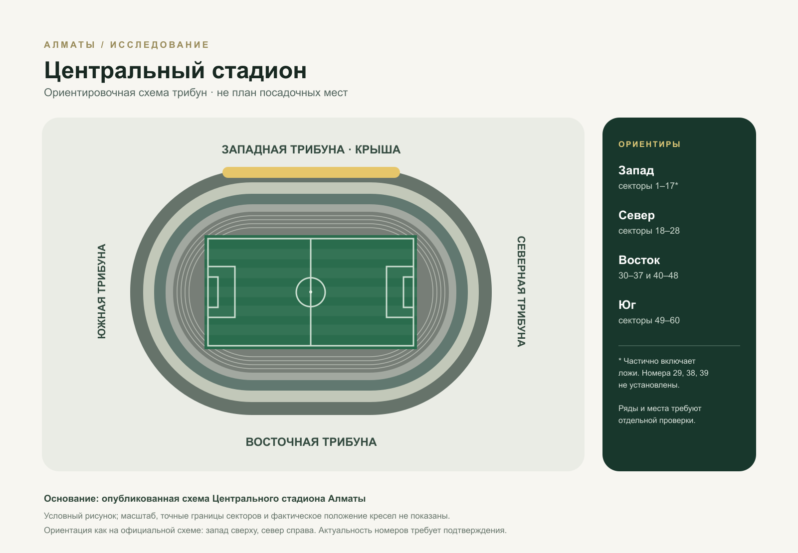

# Центральный стадион Алматы: основа для реалистичного сайта

Исследование на 21 ноября 2026 года. Цель: подобрать подтверждённые источники и определить, как сделать красивый, быстрый сайт, показывающий посетителю вид с выбранного места. Это исследование и обзорная схема; сам сайт, 3D-модель и виды с кресел ещё не созданы.

## Главное решение

Для первого пилота предлагается лёгкая схема выбора и качественный панорамный обзор с одной подтверждённой точки. Это позволит оценить реализм и скорость на телефоне до создания всей арены. Затем, если требуется свободно показывать *каждое* место, нужен цифровой двойник с проверенными координатами кресел и препятствий. Панорамы из него можно отрисовать заранее либо показывать саму 3D-сцену; лучший вариант определяется замерами готового пилота, а не предположениями.

**Достоверность:** реальную панораму можно назвать видом с конкретного места только тогда, когда точка съёмки привязана к этому месту. Соседний ряд — приблизительный вид. Предрендеренная 3D-панорама — визуализация, точность которой зависит от качества модели. Без достоверной привязки нужно обозначать «примерный вид из сектора».

[Открыть схему SVG](stadium-scheme.svg) · [Официальная схема](https://centralstadium.kz/shema-stadiona/)

На схеме западная трибуна расположена сверху, северная справа — как на официальном рисунке. На нём различимы западные блоки 1–17, северные 18–28, восточные 30–37 и 40–48, южные 49–60. В западной части обозначены также ложи. Номера 29, 38 и 39 на рисунке не установлены: это не означает, что их не существует. Точное положение границ на нашей схеме **условное**, а дата и актуальность официальной схемы неизвестны. Ряды и места она не показывает. [Источник 01](sources/01.md).

## Что найдено

- На сайте стадиона опубликована [официальная схема](https://centralstadium.kz/shema-stadiona/) и описание с размером игрового поля 105 × 68 м. На той же странице 23 804 места приводятся в историческом контексте; для фактического количества на мероприятии нужна отдельная проверка. [01](sources/01.md), [02](sources/02.md).
- Акимат сообщал об обновлении трибун и более 1500 сидений в 2025 году. Поэтому прежние фотографии полезны для архитектуры, но не всегда для текущего цвета и состояния. [04](sources/04.md).
- В сентябре 2025 Kazinform приводил 22 800 мест со ссылкой на руководство, а историческая страница стадиона — 23 804 после замены сидений в 1997 году. Эти значения относятся к разным датам и условиям, и ни одно не следует без проверки использовать как текущее количество продаваемых мест. [02](sources/02.md), [03](sources/03.md).
- В октябре 2026 Kazinform со ссылкой на акима района сообщил, что прежний проект расширения отложен; срок капитального ремонта не назван. Это сообщение на конкретную дату, а не обследование на ноябрь. Не подменять существующий стадион рендерами другого нового стадиона. [09](sources/09.md).
- Google Earth позволил осмотреть общую форму; открытая точка 360° оказалась воздушной, а не панорамой с сиденья. Дата изображения и точность рядов в этом просмотре не подтверждены. Использование Google-контента в самом продукте требует проверки условий соответствующего сервиса. [20](sources/20.md).

## Фотографии в 2ГИС — дополнение

[Галерея Центрального стадиона в 2ГИС](https://2gis.kz/almaty/gallery/firm/9429940000802132) содержит фотографии зрителей и посетителей. На 21.11.2026 сервис показывал 2 301 материал в разделе «Все» и 1 105 в категории «Внутри». Счётчики могут меняться; они не означают 1 105 видов с разных кресел.

Просмотрены шесть конкретных снимков. Особенно полезны:

- [Поле и крытая трибуна на закате](https://2gis.kz/almaty/gallery/firm/9429940000802132/photoId/30258560329467207) — Darkhan Nasikhat, дата в 2ГИС 03.08.2026.
- [Ряды и общий вид поля](https://2gis.kz/almaty/gallery/firm/9429940000802132/photoId/30258560248175918) — m1stx ee, дата в 2ГИС 28.07.2025.
- [Вечерний свет, поле и ограждения](https://2gis.kz/almaty/gallery/firm/9429940000802132/photoId/30258560315484559) — Daniyar Damiruly, дата в 2ГИС 23.05.2026.
- [Поле, трибуны и мероприятие](https://2gis.kz/almaty/gallery/firm/9429940000802132/photoId/30258560334061819) — Aidana Anuarbek, дата в 2ГИС 25.08.2026.
- [Вид из-под навеса на поле и противоположную трибуну](https://2gis.kz/almaty/gallery/firm/9429940000802132/photoId/30258560326761001) — Yesk🌍🏔️, дата в 2ГИС 20.07.2026.

Это хорошие визуальные референсы для пропорций на уровне зрителя, крыши и освещения. Отображаемая дата может быть датой публикации; реальное место и сектор съёмки не подтверждены. Для точной модели их нужно сопоставить с планом и дополнительными фотографиями. Права на размещение в будущем сайте или применение как текстур не установлены. [Протокол просмотра](sources/23.md).

## Фотографии и планы

| Референс | Что смотреть | Дата и ограничения |
|---|---|---|
| [Фоторепортаж Kazinform](https://www.inform.kz/ru/almati-gotovitsya-k-priezdu-reala-fotoreportazh-s-tsentralnogo-stadiona-464704) | Внутренний вид поля, трибун и подготовка к матчу. Фото Александра Павского / Kazinform | 25.09.2025; использовать как референс, права на публикацию и использование в текстурах уточнить. [03](sources/03.md) |
| [Фоторепортаж Informburo](https://informburo.kz/novosti/gotov-li-centralnyi-stadion-almaty-priniat-koncert-dzennifer-lopes-fotoreportaz-informburokz) | Входы, фасады, ступени и интерьер | 04.06.2025, до осеннего обновления. Концертная подготовка может быть временной. [05](sources/05.md) |
| [Трибуны перед матчем «Кайрат» — «Реал»](https://kz.kursiv.media/2025-09-30/mgpz-kairat-real-obstanovka-na-tsentralnom-pered-igroy/) | Вечерняя атмосфера, зрители и освещение | 30.09.2025; конкретное мероприятие. [06](sources/06.md) |
| [TengriSport: стадион после концерта](https://tengrisport.kz/tnsport/mestami-vyigorelo-kayrate-vyiskazalis-pole-kontserta-kane-606526/amp/) | Более недавние фото поля и временных работ | 19.08.2026; это состояние восстановления, а не постоянная футбольная конфигурация. [07](sources/07.md) |
| [Официальный план секторов](https://centralstadium.kz/shema-stadiona/) | Расположение трибун и групп секторов | Дата не указана; без схемы кресел и высот. [01](sources/01.md) |
| [План QFL](https://qfl.kz/ru/news/startuet-onlayn-prodazha-biletov-na-finalnyy-match-kubka-rk-3770/) | Дополнительная историческая схема | 2016; для сравнения, не как доказательство актуальности. [10](sources/10.md) |
| [Wikimedia Commons: категория стадиона](https://commons.wikimedia.org/wiki/Category:Almaty_Central_Stadium) | Исторические и фасадные снимки | Проверять авторство, лицензию и дату каждого файла. Снимки 2022a–c показывают стенды со старыми фотографиями, а не актуальный интерьер. [13](sources/13.md) |
| [Фасад сбоку, 2022d](https://commons.wikimedia.org/wiki/File:Ortalyq-Almaty_2022d.jpg) · [главный фасад, 2022e](https://commons.wikimedia.org/wiki/File:Ortalyq-Almaty_2022e.jpg) | Архитектура снаружи | Автор CD, CC BY-SA 4.0 согласно карточкам файлов. При использовании соблюдать атрибуцию и условия лицензии; не считать снимки современным видом трибун. [21](sources/21.md), [22](sources/22.md) |

Фотографии прессы здесь собраны **ссылками**, а не скопированы в материалы проекта. Для публикации, создания текстур или использования 360°-снимков необходимо подтвердить права у правообладателя.

## Каким должен быть продукт

**Визуально.** Крупный узнаваемый обзор стадиона, спокойный интерфейс поверх сцены и минимум лишних элементов. Подписи помогают быстро понять, где поле и трибуны. Основное внимание — на качество вида с места: естественный свет, реальные материалы, правильная высота камеры и узнаваемые детали. Модель не должна выглядеть как общий овальный стадион, случайно подписанный «Алматы».

**Взаимодействие.** Выбор трибуны → сектор → ряд и место, когда появятся проверенные данные → просмотр с возможностью вращения. На каждом шаге сохраняется контекст выбранного места. Нужна также альтернатива выбору только мышью: список и поиск по номеру, а на телефоне — управление касанием.

**Лёгкость.** Начальный интерфейс и схема загружаются первыми; нужный вид — после выбора. В 3D-подходе повторяющиеся кресла можно отображать экземплярами, а модель и текстуры сжимать после проверки качества. Three.js поддерживает такую отрисовку, выбор экземпляров и загрузку glTF, но само по себе это не гарантирует определённую скорость. [15](sources/15.md), [16](sources/16.md), [17](sources/17.md).

**Практическое измерение.** Проверять первый показ, объём загружаемых данных, плавность перемещения и память на реальных телефонах и компьютерах. Следить за показателями загрузки и отзывчивости сайта, используя Web Vitals как ориентир; итоговые показатели именно этого проекта пока не измерены. [18](sources/18.md).

## Чего пока не хватает

1. Актуальной схемы «сектор → ряд → место» и официальной расшифровки спорных номеров.
2. Координат и высот кресел, наклона трибун, размеров проходов, положения перил и колонн.
3. Фотографий или панорам с зафиксированных точек: минимум несколько ракурсов ближних и дальних рядов, места около проходов, перил и за воротами.
4. Сведений об изменениях при конкретном событии: сцена, камеры, ограждения, закрытые места.
5. Разрешений на использование модели, фотографий, изображений брендов и других материалов.

Схема и фотографии дают основу для внешнего вида, но не подтверждают видимость с каждого сиденья. [01](sources/01.md), [12](sources/12.md), [14](sources/14.md).

## Проверка гипотез и критический разбор

- **Достаточно ли официальной схемы для точного вида каждого кресла? Нет.** На ней отсутствуют координаты, высоты и даже отдельные места. Привязку необходимо получить и проверить.
- **Можно ли добиться фотореализма по открытым фото? Частично и не доказано для каждого места.** Фоторепортажи дают материалы разных дат, а не набор измеренных панорам с каждого кресла.
- **Гибрид всегда легче полноценного 3D? Не доказано.** Это обоснованный кандидат для пилота; результат зависит от размера панорам, модели, устройства и сети. Съёмка тысяч фотографий тоже может быть дорогой.
- **Совпадают ли все опубликованные схемы с текущими билетами? Не подтверждено.** Схемы привязаны к разным годам и мероприятиям; требуется сверка с дирекцией или билетным оператором.
- **Противоположный вариант:** полноценная 3D-сцена может лучше подходить, если важны непрерывное перемещение, смена сцены и индивидуальный вид из каждого кресла. Цена — точная модель, настройка материалов и проверка скорости на устройствах. Предварительно сгенерированные панорамы уменьшают требования к устройству, но требуют хранения и обновления.

Для отдельных обобщений найдено меньше трёх независимых источников разных типов. В частности, по текущей нумерации и точности seat view доказательств недостаточно. Официальный источник прямо обозначен там, где подтверждён лишь сам факт публикации.

## Предлагаемый пилот

1. Взять **один подтверждённый сектор** и выбрать несколько контрольных точек: ближе к полю, выше, около прохода и возможного препятствия.
2. Получить актуальную схему и фотографии/панорамы этих точек либо доступ к съёмке.
3. Собрать аккуратный экран выбора и один реалистичный вид; явно указать источник и точность.
4. Сверить вид с фотографиями и проверить работу на телефоне. По результатам решить, масштабировать панорамы или строить полный цифровой двойник.

## Состав исследования

[Каталог источников](sources.csv) · [План](plan.md) · [Что обновлять](refresh_targets.md) · [Выводы по данным мест](findings/F1_seat_data.md) · [Выводы по изображениям](findings/F2_photos.md) · [Технологии](findings/F3_rendering.md) · [Реконструкция](findings/F4_current.md)

## Найденная игровая модель

[Almaty Central Stadium для PES 2021, автор DAV](https://www.pesmodding.com/2025/12/pes-2021-almaty-central-stadium-fc.html) — модель именно этого стадиона. Она распространяется как мод для игры; право коммерческого использования, исходные права на все компоненты и возможность экспорта в GLB не подтверждены. [Публикация о моде](https://www.kazemario.com/2025/12/pes-2021-almaty-central-stadium-fc.html) указывает на права автора и разработчика игры. [Тема автора на Evo-Web](https://evoweb.uk/threads/new-almaty-central-stadium-fc-kairat-almaty-all-stadiums-by-dav.87766/) обнаружена через каталог форума, но сама тема при автоматическом открытии вернула 403. Модель в проект не включена. До использования нужны разрешения правообладателей, проверка формата и оценка пригодности для веба.
